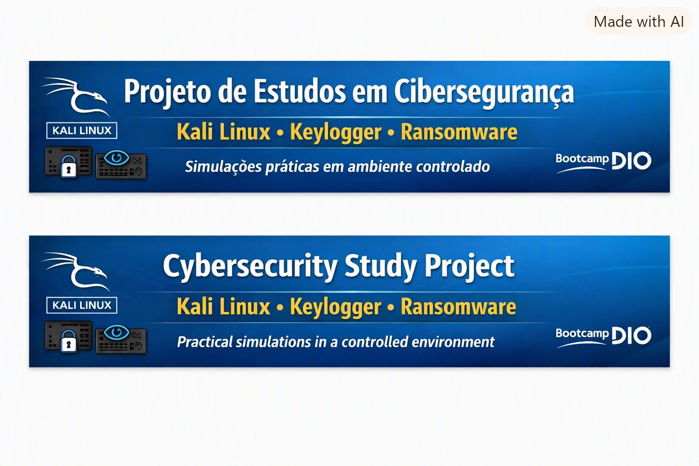

# 🛡️ Projeto de Cibersegurança / Cybersecurity Project

Este repositório reúne estudos e simulações em ambiente controlado, com finalidade exclusivamente educacional e de aprendizado em Cibersegurança.  
This repository brings together studies and simulations in a controlled environment, for educational and learning purposes in Cybersecurity.

⚠️ Todos os testes descritos devem ser realizados somente em sistemas próprios ou com autorização explícita.  
⚠️ All tests described must be performed only on your own systems or with explicit authorization.

---

---

## 📂 Estrutura do Projeto / Project Structure

Ciberseguranca/
│
├── assets/
│   └── banner.png
│
├── kali-linux/
│   └── README.md
│
├── keylogger/
│   ├── README.md
│   ├── codigo_keylogger.py
│   └── evidencias/
│       ├── Resultado_keylogger.png
│       └── Evidencia_captura.png
│
└── ransomware/
├── README.md
├── ransomware.py
└── evidencias/
├── arqs_criptografados.png
├── arqs_descriptografia.png
├── Visual_Codigo.png
└── Evidencia1.png

---

## 🔎 Projetos Práticos / Practical Projects

### Kali Linux
Enumeração e testes de autenticação utilizando ferramentas do Kali Linux.  
Enumeration and authentication testing using Kali Linux tools.  
➡️ [Ver detalhes / See details](./kali-linux/README.md)

### Keylogger
Simulação de captura de teclas e envio automático por e-mail.  
Simulation of keystroke capture and automatic email exfiltration.  
➡️ [Ver detalhes / See details](./keylogger/README.md)

### Ransomware
Simulação de criptografia e descriptografia de arquivos, com geração de mensagem de resgate.  
Simulation of file encryption and decryption, with ransom note generation.  
➡️ [Ver detalhes / See details](./ransomware/README.md)

---

## 🛡️ Reflexões Gerais / General Reflections

- **Impacto dos ataques simulados / Impact of simulated attacks**  
  Mesmo códigos simples podem comprometer dados sensíveis.  
  Even simple code can compromise sensitive data.  

- **Importância da defesa / Importance of defense**  
  Antivírus, firewall, sandboxing e monitoramento contínuo são essenciais.  
  Antivirus, firewall, sandboxing, and continuous monitoring are essential.  

- **Conscientização do usuário / User awareness**  
  Engenharia social e descuido são portas de entrada para ataques.  
  Social engineering and carelessness are gateways for attacks.  

- **Aprendizado prático / Practical learning**  
  Simular ataques em laboratório ajuda a entender como funcionam e como preveni-los.  
  Simulating attacks in a lab helps understand how they work and how to prevent them.  

---

## 📚 Conclusão / Conclusion

Os estudos realizados — **Kali Linux, Keylogger e Ransomware** — mostram que a cibersegurança não é apenas sobre ferramentas, mas sobre **estratégia e prevenção**.  
The studies carried out — **Kali Linux, Keylogger, and Ransomware** — show that cybersecurity is not only about tools, but about **strategy and prevention**.  

A defesa eficaz depende tanto da tecnologia quanto da **educação e vigilância dos usuários**.  
Effective defense depends as much on technology as on **user education and vigilance**.  

Este repositório é uma coleção de práticas que reforçam a importância de unir conhecimento técnico e consciência crítica para proteger sistemas e informações.  
This repository is a collection of practices that reinforce the importance of combining technical knowledge and critical awareness to protect systems and information.

