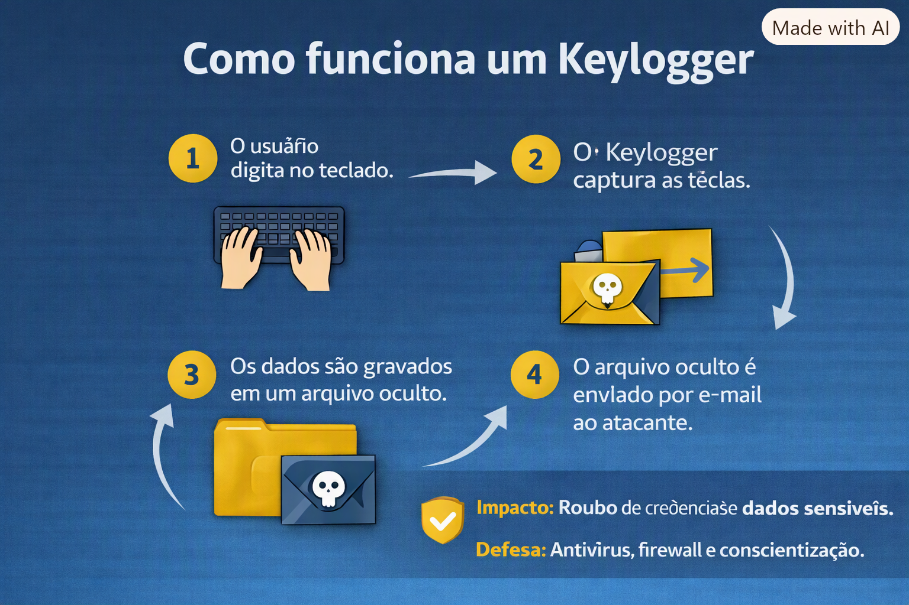

# 🔑 Projeto Keylogger (Simulado)

## 🇧🇷 Descrição (Português)
Este projeto simula o funcionamento de um **Keylogger** em ambiente controlado, com finalidade exclusivamente educacional.  
O código captura teclas digitadas, armazena em arquivo `.txt` e implementa envio automático por e-mail.

### 🎯 Objetivos
- Captura de teclas digitadas.
- Registro em arquivo de texto.
- Envio automático por e-mail.
- Tornar o processo mais furtivo.

### 📊 Infográfico

### 🔎 Evidências
- Resultado da captura de teclas:  
  

- Envio automático por e-mail:  
  

---

## 🇺🇸 Description (English)
This project simulates the behavior of a **Keylogger** in a controlled environment, for educational purposes only.  
The code captures keystrokes, stores them in a `.txt` file, and implements automatic email exfiltration.

### 🎯 Objectives
- Capture keystrokes.
- Log into a text file.
- Automatic email exfiltration.
- Make the process stealthier.

### 🔎 Evidence
- Keystroke capture results:  
  

- Automatic email exfiltration:  
  

---

## 🛡️ Reflexão / Reflection
Este estudo mostra como algo simples pode gerar impacto significativo.  
Mais importante que entender o ataque é refletir sobre **defesa e prevenção**: antivírus, firewall, sandboxing e conscientização do usuário.  
This study shows how something simple can have a significant impact.  
More important than understanding the attack is reflecting on **defense and prevention**: antivirus, firewall, sandboxing, and user awareness.
