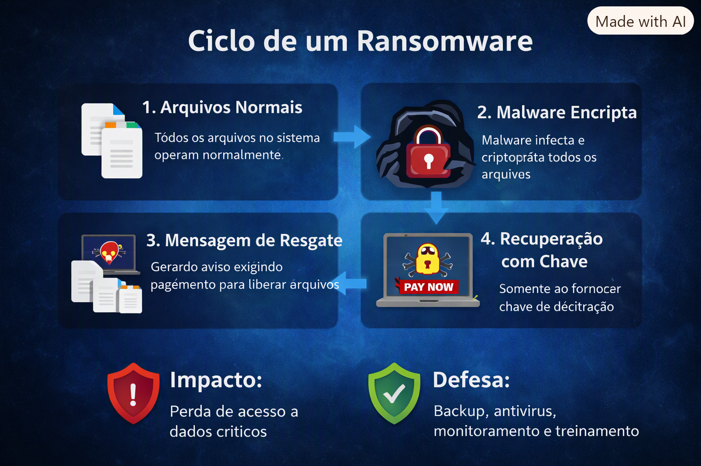

# 🔐 Projeto Ransomware (Simulado)

## 🇧🇷 Descrição (Português)
Este projeto simula o funcionamento de um **Ransomware** em ambiente controlado, com finalidade exclusivamente educacional.  
O código criptografa arquivos de teste, gera mensagem de resgate e permite a descriptografia com chave.

### 🎯 Objetivos
- Criação de arquivos de teste.
- Criptografia e descriptografia.
- Geração de mensagem de resgate simulada.

### 📊 Infográfico

### 🔎 Evidências
- Arquivos criptografados:  
  

- Arquivos descriptografados:  
  

- Execução do código no VS Code:  
  

- Mensagem de resgate gerada:  
  

---

## 🇺🇸 Description (English)
This project simulates the behavior of **Ransomware** in a controlled environment, for educational purposes only.  
The code encrypts test files, generates a ransom note, and allows decryption with a key.

### 🎯 Objectives
- Create test files.
- Encrypt and decrypt files.
- Generate a simulated ransom note.

### 🔎 Evidence
- Encrypted files:  
  

- Decrypted files:  
  

- Code execution in VS Code:  
  

- Generated ransom note:  
  

---

## 🛡️ Reflexão / Reflection
Este estudo demonstra como **malwares simples podem causar grandes impactos**.  
Mais importante que entender o ataque é refletir sobre **defesa e prevenção**: antivírus, firewall, sandboxing, monitoramento e conscientização do usuário.  
This study demonstrates how **simple malware can cause major impacts**.  
More important than understanding the attack is reflecting on **defense and prevention**: antivirus, firewall, sandboxing, monitoring, and user awareness.
